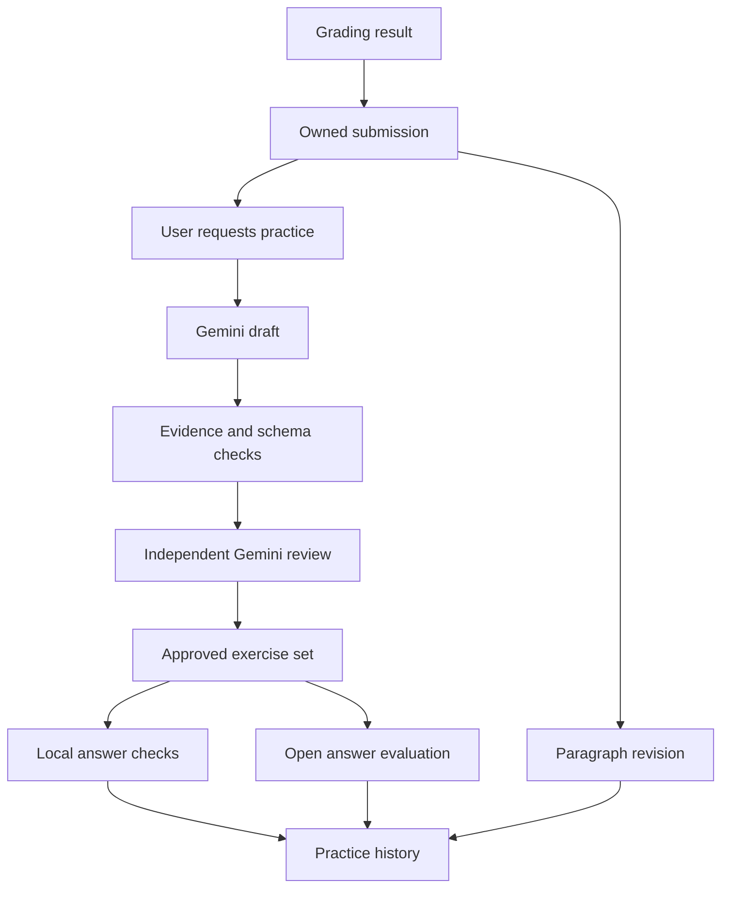

# Personalized practice architecture

## Separation and flow

Grading is unchanged. Successful grading persists the submitted question, essay and returned feedback under an opaque browser session, then returns submission_id. Only the learner's Generate Practice action starts exercise generation.

## Modules

| File under backend/app/practice | Responsibility |
|---|---|
| schemas.py | Strict error, exercise, review, answer and public API contracts |
| diagnosis.py | Literal evidence offsets, taxonomy, deduplication, priority and exercise checks |
| prompts.py | Separate generation, semantic review and answer prompts |
| service.py | Bounded orchestration, locks, evaluation, hints and safe public projection |
| store.py | SQLite ownership, persistence and progress |
| routes.py | Browser session cookie and FastAPI endpoints |

Frontend practice.jsx contains cards, staged navigation, answer/hint controls, revision editor and progress. Existing styling is extended with scoped practice styles.

## Taxonomy

GRA: subject-verb agreement, tense, articles, prepositions, sentence structure, fragments, run-ons, word forms, grammatical range, punctuation.

LR: word choice, collocation, repetition, unnatural phrasing, register, word formation.

CC: paragraph progression, linking devices, unclear reference, logical gaps, paragraph structure.

TR: underdeveloped ideas, unsupported claims, irrelevant examples, missing explanation, incomplete response, unclear position.

Exact subtype identifiers live in schemas.TAXONOMY. Broad range/style comments cannot become definite grammar errors without an actionable, evidenced problem.

## Contracts and gates

Errors contain stable error_id, category/criterion/subtype, exact original_quote, correction, explanation, severity, paragraph_number, source offsets, recurrence, evidence_verified, exercise_eligible and semantic_status. An ambiguous or missing quote is rejected. Duplicate location/type records are removed; optional style edits are excluded.

Exercise types: multiple_choice, error_identification, sentence_correction, sentence_rewriting, paragraph_revision and error_imitation. Common fields include source_error_id, skill, difficulty, instruction, question, options, correct_answer, accepted_alternatives, target_span, explanation, hint, objective and rubric. The flat strict schema supports type-specific checks. New contexts are required except original-paragraph revision.

Structural gates check source linkage, skill, stage, evidence, distinct MCQ options, key membership, unique target span, duplicate questions and suspicious instruction/answer markers. An independent model response must approve alignment, key, ambiguity, explanation, difficulty, distractors, leakage and injection. Missing/duplicate judgments fail closed. This is automated review, not lecturer certification.

## Persistence and boundaries

SQLite tables: practice_sessions, submissions, practice_batches, exercises, answers, hints, revisions, practice_calls and study_observations. Provider raw outputs and metadata remain server-side. Credentials and answer keys never enter public pre-answer DTOs. Cookie tokens are random capabilities, hashed at rest, HttpOnly, SameSite=Strict, and Secure on HTTPS. Sessions expire after 30 days. This is browser ownership, not multi-device account authentication.

Generation uses a per-submission file lock and ready-result caching, with at most two generation operations. Each provider request permits one retry and uses the existing shared quota. An interrupted pending batch is not automatically regenerated. Answer requests are reserved before evaluation; request IDs prevent duplicate billing and payload conflicts return 409. Completed duplicate answers are reused. Each exercise allows at most five completed attempts; revisions allow five requests. File locks support this single-machine SQLite deployment, not distributed workers across hosts.

Progress reports completed exercises, first-attempt and unassisted accuracy, hints, practiced skills, categories, repeated in-essay patterns, and saved before/after revisions. Revision feedback records whether targets were addressed. These are practice statistics, not validated language proficiency. Future study fields are inactive; no random assignment or intervention effects are implemented.
